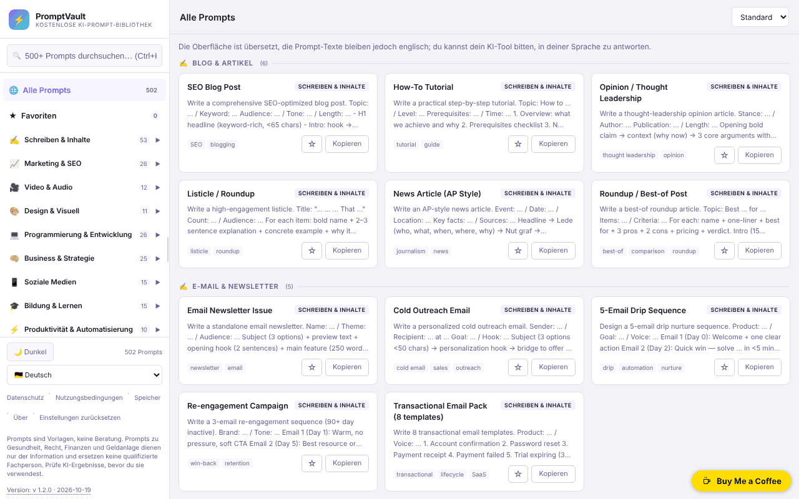

# PromptVault

[English](README.md) · [Română](README.ro.md) · [Français](README.fr.md) · [Italiano](README.it.md) · [Español](README.es.md) · [Português](README.pt.md) · **Deutsch** · [Magyar](README.hu.md)

**Version:** 1.2.3 · **Zuletzt aktualisiert:** 2026-10-22

Oberflächensprachen: **Română, English, Français, Italiano, Español, Português (PT), Deutsch, Magyar** + 8 weitere

Eine kostenlose Bibliothek mit KI-Prompts in einer einzigen HTML-Datei, mit Suche, Kategorien und einer Oberfläche in 16 Sprachen.

**Online-App:** https://chiuta.github.io/PromptVault/

## Was es ist

PromptVault ist eine Bibliothek von Prompts für Werkzeuge der künstlichen Intelligenz, geordnet nach Kategorien (Schreiben, Marketing, Video und Audio, Design, Programmierung usw.). Laut der „About“-Seite der App enthält sie über 500 Prompts in 62 Kategorien. Alles steckt in einer einzigen Datei `index.html`, ohne Konto und ohne Bezahlung; der Prompt wird mit einem Klick kopiert und in das bevorzugte KI-Werkzeug eingefügt.

## Funktionen

- Suche in den Prompts, mit dem Tastenkürzel **Strg+K** (oder Cmd+K), um den Cursor ins Suchfeld zu setzen.
- Navigation nach Kategorien und Unterkategorien in einem Seitenpanel (auf schmalen Bildschirmen öffnet es sich mit der Schaltfläche ☰).
- Sortierung: „Default“, „A→Z“, „Z→A“.
- **Ausfüllen von [PLACEHOLDER]n** im Prompt-Fenster: Alle 502 Prompts enthalten Platzhalter der Form `[TOPIC]`; das Panel „Lücken ausfüllen“ erzeugt für jeden ein Feld, die Vorschau aktualisiert sich live, und „Copy prompt“ kopiert den ausgefüllten Text (die Werte werden nirgends gespeichert).
- **Antwort in der Sprache der Oberfläche** (Sprachen ≠ Englisch): Option im Prompt-Fenster, die am Ende den Satz „Please write your answer in <Sprache>.“ anhängt; der Prompt selbst bleibt auf Englisch. Die neuen Texte sind in alle 16 Sprachen übersetzt.
- Schaltfläche **Copy prompt** (Prompt kopieren) im Detailfenster jedes Prompts, dazu eine Schaltfläche **Copy** auf der Karte.
- Helles / dunkles Design (Schaltfläche ☀️ Light / 🌙 Dark); beim ersten Start wird die Systemeinstellung übernommen.
- 16 Oberflächensprachen: Englisch, Rumänisch, Spanisch, Französisch, Deutsch, Italienisch, Portugiesisch, Niederländisch, Polnisch, Russisch, Arabisch, Chinesisch, Japanisch, Koreanisch, Türkisch, Ungarisch.
- Seitenpanel durch Ziehen oder mit den Pfeiltasten links/rechts, Pos1 und Ende in der Größe veränderbar, wenn der Griff den Fokus hat.
- **Favoriten**: Die Schaltfläche ☆ auf der Karte oder „☆ In Favoriten speichern“ im Prompt-Fenster markiert einen Prompt; der Eintrag „★ Favoriten“ im Seitenpanel (mit Zähler) listet sie auf. Die Liste wird nur in diesem Browser gespeichert (`pv_fav`), in 16 Sprachen.
- Informationsfenster: Privacy, Terms, Storage, About; Schaltfläche **Reset** zum Löschen der gespeicherten Einstellungen (und der Favoriten, nach Bestätigung).
- Versucht, sich als PWA zu registrieren (Manifest und Service Worker aus dem Code erzeugt, nur über sichere Verbindungen / HTTPS).

## Anleitung

1. Öffne die Seite (oder die Datei `index.html` lokal).
2. Wähle die Sprache aus der Liste „Language“ in der Seitenleiste.
3. Wähle eine Kategorie in der Seitenleiste oder drücke **Strg+K** und gib ein Stichwort ins Suchfeld ein.
4. Ändere optional die Reihenfolge mit der Liste „Sort“.
5. Klicke auf eine Karte, um den vollständigen Prompt zu öffnen; drücke **Copy prompt**, um ihn in die Zwischenablage zu kopieren. Blockiert der Browser das Kopieren, bittet dich die App, den Text manuell auszuwählen und zu kopieren.
6. Schließe das Fenster mit **Close**, mit ✕ oder mit **Esc**.
7. Um gespeicherte Einstellungen (Design, Panelbreite, Sprache, Favoriten) zu löschen, drücke **Reset** in der Fußzeile.

## Datenschutz und Netzwerk

- **Lokaler Speicher (localStorage):** vier Schlüssel, `pv_theme` (Design), `pv_sw` (Breite des Seitenpanels), `pv_lang` (Sprache) und `pv_fav` (Liste der Favoritentitel). Es werden keine Cookies verwendet. Die Daten verlassen das Gerät nicht.
- **Netzwerk:** Im Code der App gibt es keine Anfragen an Drittserver und keine von außen geladenen Skripte, Schriften oder Bilder. Die Links in der App (Buy Me a Coffee, alexio.tf, GitHub) öffnen sich nur, wenn du sie anklickst.
- Der lokal erzeugte Service Worker fängt GET-Anfragen an dieselbe Origin ab und legt sie zur späteren Wiederverwendung im Cache ab; er kontaktiert keine anderen Hosts.
- Die App enthält weder Analytics noch Telemetrie.

## Einschränkungen und Haftungsausschluss

Die Prompts sind Vorlagen, keine Ratschläge. Die Kategorien Gesundheit, psychische Gesundheit, Medizin, Recht, Buchhaltung/Steuern, Investitionen/Trading und Versicherungen sind rein informativ und ersetzen keinen Fachmann; von der KI erzeugte Ergebnisse müssen überprüft werden. Ein entsprechender Hinweis wird in der Fußzeile der Seitenleiste angezeigt (auf Englisch).

## Lokal / offline ausführen

Lade `index.html` herunter und öffne sie in einem Browser. Alle Prompts, Texte und Sprachen befinden sich in der Datei, daher funktioniert sie ohne Internet. Die PWA-/Service-Worker-Funktion setzt die Auslieferung über HTTPS voraus (sie funktioniert nicht, wenn die Datei lokal geöffnet wird); externe Links benötigen Internet.

## Lizenz

MIT — siehe die Datei LICENSE.

Die Texte „About“ und „Terms“ in der Oberfläche (in allen 16 Sprachen) nennen jetzt dieselbe Lizenz, MIT.

## Audit

Audit: 2026-10-10 — Die Aussagen der README zu Netzwerk und Speicher stimmen mit dem Code überein (das einzige `fetch` steckt im lokal erzeugten Service Worker, für dieselbe Origin; CSP `connect-src 'none'`). Die auf der Seite angegebene Lizenz wurde in allen Sprachen vereinheitlicht (2026-10-11; derzeit MIT); der Haftungsausschluss in der Fußzeile ist jetzt in alle 15 Sprachen übersetzt.

## Autor

Alexio — Alexandru-Ionuț Chiuță. Kontakt: alexio@trom.tf

## Zusammenfassung

PromptVault ist eine clientseitige Bibliothek von KI-Prompts in einer einzigen Datei (laut Info-Seite über 500 in 62 Kategorien) mit Suche (Strg+K), Sortierung, Kopieren mit einem Klick, hellem/dunklem Design und 16 Oberflächensprachen. Im localStorage werden nur Design, Seitenleistenbreite, Sprache und deine Favoritenliste gespeichert; es werden keine Ressourcen von Dritten geladen; externe Links öffnen sich nur per Klick. Funktioniert offline, wenn heruntergeladen; die optionale PWA-Funktion benötigt HTTPS. MIT-lizenziert.

## Verlauf / Changelog

- 1.2.3 — 2026-10-22: Echte `sw.js` + Manifest + Icons (der ungültige blob:-Service-Worker ist entfernt, die Offline-Hülle funktioniert daher nach dem ersten Besuch); die vier alert()/confirm()-Aufrufe sind durch Hinweise in der Seite und einen Dialog ersetzt; die fehlenden Texte „Kopieren fehlgeschlagen“ und „Favoriten zurücksetzen“ sind in den 8 Sprachen ergänzt (die Bestätigung zeigte einen rohen Schlüssel); Text ≥ 12 px auf dem Handy.

- 1.2.2 — 2026-10-22: **Korrektur**: die Beschriftung (für Screenreader) der Sprachauswahl folgt jetzt der gewählten Sprache.
### 1.2.1 — 2026-10-22
- Übersetzungskorrekturen: Titel und Tags der Prompts sind auf ro, fr, it, es, pt, de und hu übersetzt (Suche und Sortierung funktionieren in der gewählten Sprache); Barrierefreiheits-Labels und Sprunglink folgen der Oberflächensprache. Die Prompt-Texte bleiben bewusst englisch (sie werden in KI-Tools eingefügt).

### 1.1.0 — 2026-10-14
- Datensicherung und Datenkennzeichnung (fff-kit).

### 12. Oktober 2026 (v1.0.0)
- 1.0.0 — 2026-10-12: Die Version und das Datum der letzten Aktualisierung werden in der App angezeigt

### 11. Oktober 2026
- Favoriten (☆/★ auf der Karte und im Prompt-Fenster, Eintrag „★ Favoriten“ mit Zähler im Seitenpanel, Persistenz in `localStorage` unter `pv_fav`, 15 Sprachen); die „Storage“-Richtlinie der App listet jetzt auch `pv_fav` auf (statt „drei Einstellungen“).
- Behoben: Der globale `aside`-Stil der App wurde auch auf die Spenden-Pille (`#tf-donate`) angewendet, daher das weiße Rechteck in der Ecke des Screenshots und die abgeschnittene ✕-Schaltfläche; auf Mobilgeräten konnte die Pille aus dem Bildschirm geschoben werden. Die Regel der Pille setzt jetzt die geerbten Eigenschaften zurück.
- `screenshot.png` aktualisiert (1280×800, Oberfläche auf Rumänisch).
- Prompt-Fenster: interaktives Ausfüllen der `[PLACEHOLDER]` (Kopieren mit den ausgefüllten Werten) und Option „in der Sprache der Oberfläche antworten“, in 15 Sprachen; in Chromium getestet (Vorschau, Zwischenablage, 360 px ohne horizontales Scrollen).
- CSP: `script-src` per SHA-256-Hash, ohne `'unsafe-inline'`.
- Die 23 `onclick`-/`onchange`-Attribute im HTML wurden durch einen delegierten Listener (`data-act`) ersetzt; Verhalten unverändert (geprüft: Menü, Suche, Prompt-Fenster, Kopieren, Sprache, Designs, rechtliche Fenster).
- Die Zähler in der Seitenleiste (Kategorien und Unterkategorien) folgen jetzt der aktiven Suche und stimmen daher mit den angezeigten Ergebnissen überein; ohne Suche bleiben es die Gesamtwerte (502 Prompts, 62 Kategorien, 162 Unterkategorien).
- In anderen Sprachen als Englisch erscheint ein übersetzter Hinweis: Die Oberfläche ist übersetzt, die Prompt-Texte bleiben aber auf Englisch (die Übersetzung der 502 Prompts in 14 Sprachen wurde nicht durchgeführt).
- `aside` für die Spenden-Pille (axe: 0 Verstöße).
