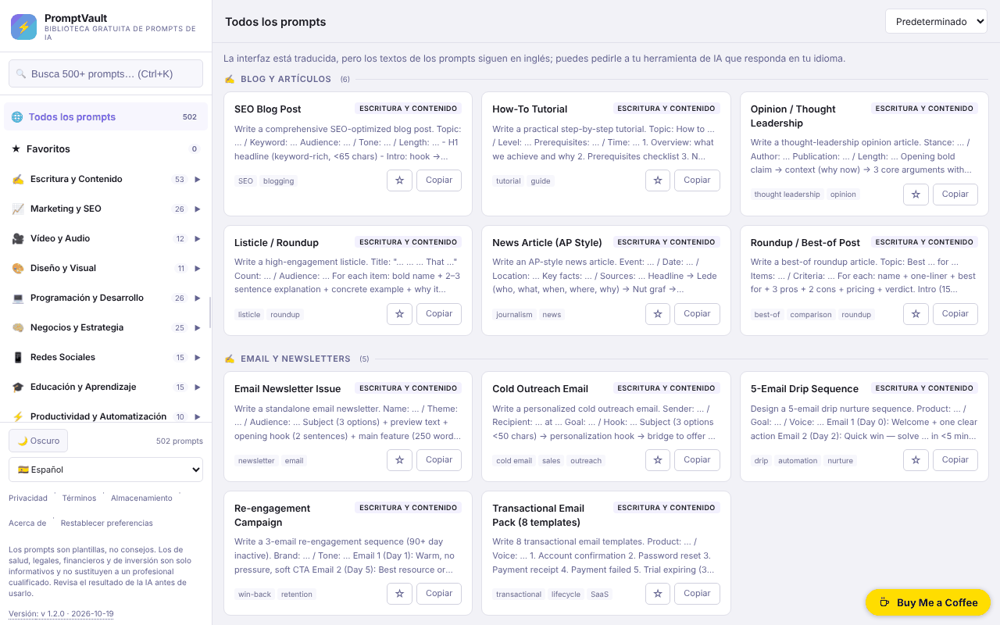

# PromptVault

[English](README.md) · [Română](README.ro.md) · [Français](README.fr.md) · [Italiano](README.it.md) · **Español** · [Português](README.pt.md) · [Deutsch](README.de.md) · [Magyar](README.hu.md)

**Versión:** 1.2.0 · **Última actualización:** 2026-10-19

Idiomas de la interfaz: **Română, English, Français, Italiano, Español, Português (PT), Deutsch, Magyar** + 8 más

Una biblioteca gratuita de prompts de IA, en un único archivo HTML, con búsqueda, categorías e interfaz en 16 idiomas.

**Aplicación en línea:** https://chiuta.github.io/PromptVault/

## Qué es

PromptVault es una biblioteca de prompts para herramientas de inteligencia artificial, organizada por categorías (escritura, marketing, vídeo y audio, diseño, programación, etc.). Según la página «About» de la aplicación, contiene más de 500 prompts en 62 categorías. Todo es un único archivo `index.html`, sin cuenta y sin pago; el prompt se copia con un clic y se pega en la herramienta de IA que prefieras.

## Funciones

- Búsqueda en los prompts, con el atajo **Ctrl+K** (o Cmd+K) para mover el cursor al campo de búsqueda.
- Navegación por categorías y subcategorías, en un panel lateral (en pantallas estrechas se abre con el botón ☰).
- Ordenación: «Default», «A→Z», «Z→A».
- **Relleno de [PLACEHOLDER]** en la ventana del prompt: los 502 prompts contienen huecos del tipo `[TOPIC]`; el panel «Completa los huecos» genera un campo para cada uno, la vista previa se actualiza en vivo y «Copy prompt» copia el texto completado (los valores no se guardan en ningún sitio).
- **Respuesta en el idioma de la interfaz** (idiomas ≠ inglés): opción en la ventana del prompt que añade al final la frase «Please write your answer in <idioma>.»; el prompt en sí sigue en inglés. Los textos nuevos están traducidos a los 16 idiomas.
- Botón **Copy prompt** (Copiar el prompt) en la ventana de detalle de cada prompt, además de un botón **Copy** en la tarjeta.
- Tema claro / oscuro (botón ☀️ Light / 🌙 Dark); en la primera ejecución sigue la preferencia del sistema.
- 16 idiomas de interfaz: inglés, rumano, español, francés, alemán, italiano, portugués, neerlandés, polaco, ruso, árabe, chino, japonés, coreano, turco, húngaro.
- Panel lateral redimensionable arrastrando o con las teclas de flecha izquierda/derecha, Inicio y Fin cuando el asa tiene el foco.
- **Favoritos**: el botón ☆ de la tarjeta o «☆ Guardar en favoritos» en la ventana del prompt marca un prompt; el elemento «★ Favoritos» del panel lateral (con contador) los lista. La lista se conserva solo en este navegador (`pv_fav`), en 16 idiomas.
- Ventanas informativas: Privacy, Terms, Storage, About; botón **Reset** para borrar las preferencias guardadas (y los favoritos, tras confirmación).
- Intenta registrarse como PWA (manifiesto y service worker generados desde el código, solo en conexiones seguras / HTTPS).

## Guía de uso

1. Abre la página (o el archivo `index.html` en local).
2. Elige el idioma en la lista «Language» de la barra lateral.
3. Elige una categoría en la barra lateral o pulsa **Ctrl+K** y escribe una palabra clave en el campo de búsqueda.
4. Opcionalmente, cambia el orden con la lista «Sort».
5. Haz clic en una tarjeta para abrir el prompt completo; pulsa **Copy prompt** para copiarlo al portapapeles. Si el navegador bloquea la copia, la aplicación te pide que lo selecciones y lo copies manualmente.
6. Cierra la ventana con **Close**, con ✕ o con **Esc**.
7. Para borrar los ajustes guardados (tema, ancho del panel, idioma, favoritos), pulsa **Reset** en el pie de página.

## Privacidad y red

- **Almacenamiento local (localStorage):** cuatro claves, `pv_theme` (tema), `pv_sw` (ancho del panel lateral), `pv_lang` (idioma) y `pv_fav` (lista de títulos favoritos). No se usan cookies. Los datos no salen del dispositivo.
- **Red:** en el código de la aplicación no hay solicitudes a servidores de terceros, ni scripts, fuentes o imágenes cargados desde el exterior. Los enlaces de la aplicación (Buy Me a Coffee, alexio.tf, GitHub) solo se abren si los pulsas.
- El service worker generado localmente intercepta las solicitudes GET al mismo origen y las guarda en caché para reutilizarlas después; no contacta con otros hosts.
- La aplicación no contiene analítica ni telemetría.

## Limitaciones y descargo de responsabilidad

Los prompts son plantillas, no consejos. Las categorías de salud, salud mental, medicina, derecho, contabilidad/fiscalidad, inversión/trading y seguros son estrictamente informativas y no sustituyen a un especialista; los resultados generados por la IA deben verificarse. Una nota en este sentido se muestra en el pie de la barra lateral (en inglés).

## Ejecución local / sin conexión

Descarga `index.html` y ábrelo en un navegador. Todos los prompts, textos e idiomas están en el archivo, por lo que funciona sin internet. La función PWA/service worker requiere servirse por HTTPS (no funciona al abrirlo como archivo local); los enlaces externos requieren internet.

## Licencia

MIT — véase el archivo LICENSE.

Los textos «About» y «Terms» de la interfaz (en los 16 idiomas) indican ahora la misma licencia, MIT.

## Auditoría

Auditoría: 2026-10-10 — las afirmaciones sobre red y almacenamiento del README coinciden con el código (el único `fetch` está en el service worker generado localmente, para el mismo origen; CSP `connect-src 'none'`). La licencia que aparece en la página se unificó en todos los idiomas (2026-10-11; actualmente MIT); la nota de pie con el descargo de responsabilidad está ahora traducida a los 15 idiomas.

## Autor

Alexio — Alexandru-Ionuț Chiuță. Contacto: alexio@trom.tf

## Resumen

PromptVault es una biblioteca de prompts de IA de un único archivo, del lado del cliente (más de 500 en 62 categorías según su página Acerca de), con búsqueda (Ctrl+K), ordenación, copia con un clic, tema claro/oscuro e interfaz en 16 idiomas. Solo guarda en localStorage el tema, el ancho de la barra lateral, el idioma y tu lista de favoritos, y no carga recursos de terceros; los enlaces externos se abren solo al hacer clic. Funciona sin conexión una vez descargado; la función PWA opcional requiere HTTPS. Licencia MIT.

## Historial / Changelog

### 1.1.0 — 2026-10-14
- Copia de seguridad y etiquetado de datos (fff-kit).

### 12 de octubre de 2026 (v1.0.0)
- 1.0.0 — 2026-10-12: la versión y la fecha de la última actualización se muestran en la aplicación

### 11 de octubre de 2026
- Favoritos (☆/★ en la tarjeta y en la ventana del prompt, elemento «★ Favoritos» con contador en el panel lateral, persistencia en `localStorage` bajo `pv_fav`, 15 idiomas); la política «Storage» de la aplicación lista ahora también `pv_fav` (en lugar de «tres preferencias»).
- Corregido: el estilo global `aside` de la aplicación se aplicaba también a la píldora de donaciones (`#tf-donate`), de ahí el rectángulo blanco en la esquina de la captura y el botón ✕ cortado; en móvil la píldora podía quedar fuera de la pantalla. La regla de la píldora restablece ahora las propiedades heredadas.
- `screenshot.png` actualizada (1280×800, interfaz en rumano).
- Ventana del prompt: relleno interactivo de los `[PLACEHOLDER]` (copia con los valores introducidos) y opción «responder en el idioma de la interfaz», en 15 idiomas; probado en Chromium (vista previa, portapapeles, 360 px sin desplazamiento horizontal).
- CSP: `script-src` con hash SHA-256, sin `'unsafe-inline'`.
- Los 23 atributos `onclick`/`onchange` del HTML se sustituyeron por un oyente delegado (`data-act`); comportamiento sin cambios (verificado: menú, búsqueda, ventana del prompt, copia, idioma, temas, ventanas legales).
- Los contadores de la barra lateral (categorías y subcategorías) siguen ahora la búsqueda activa, por lo que coinciden con los resultados mostrados; sin búsqueda se mantienen los totales (502 prompts, 62 categorías, 162 subcategorías).
- En los idiomas distintos del inglés aparece una nota traducida: la interfaz está traducida, pero los textos de los prompts siguen en inglés (no se ha hecho la traducción de los 502 prompts a 14 idiomas).
- `aside` para la píldora de donaciones (axe: 0 infracciones).
