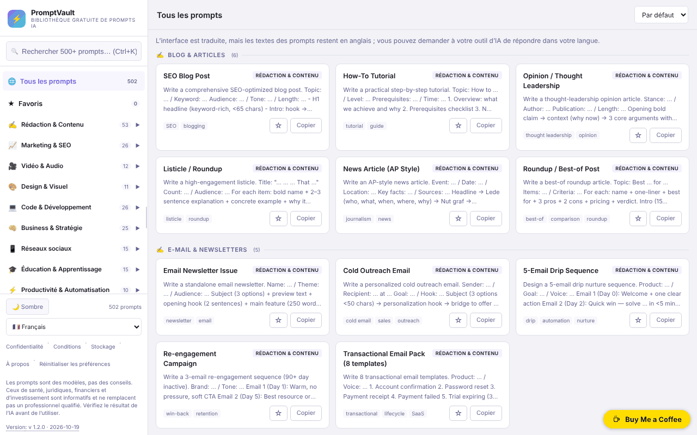

# PromptVault

[English](README.md) · [Română](README.ro.md) · **Français** · [Italiano](README.it.md) · [Español](README.es.md) · [Português](README.pt.md) · [Deutsch](README.de.md) · [Magyar](README.hu.md)

**Version :** 1.2.7 · **Dernière mise à jour :** 2026-10-23

Langues de l'interface : **Română, English, Français, Italiano, Español, Português (PT), Deutsch, Magyar** + 8 autres

Une bibliothèque gratuite de prompts d'IA, dans un seul fichier HTML, avec recherche, catégories et interface en 16 langues.

**Application en ligne :** https://chiuta.github.io/PromptVault/

## De quoi s'agit-il

PromptVault est une bibliothèque de prompts pour les outils d'intelligence artificielle, organisée par catégories (écriture, marketing, vidéo et audio, design, programmation, etc.). Selon la page « About » de l'application, elle contient plus de 500 prompts répartis en 62 catégories. Le tout tient dans un seul fichier `index.html`, sans compte et sans paiement ; le prompt se copie en un clic et se colle dans l'outil d'IA de votre choix.

## Fonctionnalités

- Recherche dans les prompts, avec le raccourci **Ctrl+K** (ou Cmd+K) pour placer le curseur dans le champ de recherche.
- Navigation par catégories et sous-catégories, dans un panneau latéral (sur les écrans étroits, il s'ouvre avec le bouton ☰).
- Tri : « Default », « A→Z », « Z→A ».
- **Remplissage des [PLACEHOLDER]** dans la fenêtre du prompt : les 502 prompts contiennent tous des emplacements du type `[TOPIC]` ; le panneau « Compléter les blancs » génère un champ pour chacun, l'aperçu se met à jour en direct, et « Copy prompt » copie le texte complété (les valeurs ne sont enregistrées nulle part).
- **Réponse dans la langue de l'interface** (langues ≠ anglais) : option dans la fenêtre du prompt qui ajoute à la fin la phrase « Please write your answer in <langue>. » ; le prompt lui-même reste en anglais. Les nouveaux textes sont traduits dans les 16 langues.
- Bouton **Copy prompt** (Copier le prompt) dans la fenêtre de détail de chaque prompt, ainsi qu'un bouton **Copy** sur la carte.
- Thème clair / sombre (bouton ☀️ Light / 🌙 Dark) ; au premier lancement, la préférence du système est suivie.
- 16 langues d'interface : anglais, roumain, espagnol, français, allemand, italien, portugais, néerlandais, polonais, russe, arabe, chinois, japonais, coréen, turc, hongrois.
- Panneau latéral redimensionnable par glissement ou avec les flèches gauche/droite, Début et Fin lorsque la poignée a le focus.
- **Favoris** : le bouton ☆ de la carte ou « ☆ Ajouter aux favoris » dans la fenêtre du prompt marque un prompt ; l'élément « ★ Favoris » du panneau latéral (avec compteur) les liste. La liste est conservée uniquement dans ce navigateur (`promptvault.fav`), en 16 langues.
- Fenêtres d'information : Privacy, Terms, Storage, About ; bouton **Reset** pour effacer les préférences enregistrées (et les favoris, après confirmation).
- Tente de s'enregistrer comme PWA (manifeste et service worker générés par le code, uniquement sur connexions sécurisées / HTTPS).

## Mode d'emploi

1. Ouvrez la page (ou le fichier `index.html` en local).
2. Choisissez la langue dans la liste « Language » de la barre latérale.
3. Choisissez une catégorie dans la barre latérale ou appuyez sur **Ctrl+K** et saisissez un mot-clé dans le champ de recherche.
4. Si vous le souhaitez, changez l'ordre avec la liste « Sort ».
5. Cliquez sur une carte pour ouvrir le prompt complet ; appuyez sur **Copy prompt** pour le copier dans le presse-papiers. Si le navigateur bloque la copie, l'application vous demande de sélectionner et de copier manuellement.
6. Fermez la fenêtre avec **Close**, avec ✕ ou avec **Échap**.
7. Pour effacer les réglages enregistrés (thème, largeur du panneau, langue, favoris), appuyez sur **Reset** dans le pied de page.

## Confidentialité et réseau

- **Stockage local (localStorage) :** quatre clés, `promptvault.theme` (thème), `promptvault.sw` (largeur du panneau latéral), `promptvault.lang` (langue) et `promptvault.fav` (liste des titres favoris). Aucun cookie n'est utilisé. Les données ne quittent pas l'appareil.
- **Réseau :** le code de l'application ne contient aucune requête vers des serveurs tiers, ni scripts, polices ou images chargés depuis l'extérieur. Les liens de l'application (Buy Me a Coffee, alexio.tf, GitHub) ne s'ouvrent que si vous cliquez dessus.
- Le service worker généré localement intercepte les requêtes GET vers la même origine et les met en cache pour une réutilisation ultérieure ; il ne contacte pas d'autres hôtes.
- L'application ne contient ni analytique ni télémétrie.

## Limites et avertissement

Les prompts sont des modèles, pas des conseils. Les catégories santé, santé mentale, médecine, droit, comptabilité/fiscalité, investissement/trading et assurances sont strictement informatives et ne remplacent pas un spécialiste ; les résultats générés par l'IA doivent être vérifiés. Une note en ce sens figure dans le pied de la barre latérale (en anglais).

## Exécution locale / hors ligne

Téléchargez `index.html` et ouvrez-le dans un navigateur. Tous les prompts, textes et langues sont dans le fichier, donc il fonctionne sans Internet. La fonction PWA/service worker nécessite un service via HTTPS (elle ne fonctionne pas à l'ouverture comme fichier local) ; les liens externes nécessitent Internet.

## Licence

MIT — voir le fichier LICENSE.

Les textes « About » et « Terms » de l'interface (dans les 16 langues) indiquent désormais la même licence, MIT.

## Audit

Audit : 2026-10-10 — les affirmations du README sur le réseau et le stockage correspondent au code (le seul `fetch` se trouve dans le service worker généré localement, pour la même origine ; CSP `connect-src 'none'`). La licence affichée dans la page a été unifiée dans toutes les langues (2026-10-11 ; actuellement MIT) ; la note de pied de page avec l'avertissement est maintenant traduite dans les 15 langues.

## Auteur

Alexio — Alexandru-Ionuț Chiuță. Contact : alexio@trom.tf

## Résumé

PromptVault est une bibliothèque de prompts d'IA côté client, en un seul fichier (plus de 500 répartis en 62 catégories d'après sa page À propos), avec recherche (Ctrl+K), tri, copie en un clic, thème clair/sombre et interface en 16 langues. Il ne stocke dans localStorage que le thème, la largeur de la barre latérale, la langue et votre liste de favoris, et ne charge aucune ressource tierce ; les liens externes ne s'ouvrent qu'au clic. Fonctionne hors ligne une fois téléchargé ; la fonction PWA facultative nécessite HTTPS. Sous licence MIT.

## Historique / Changelog

### 1.2.7 — 2026-10-23

- Les clés du stockage local utilisent désormais le préfixe `promptvault.` (`FFF.store.migrate` au démarrage, avant toute lecture) : les données existantes sont conservées automatiquement et les anciennes sauvegardes `.fff.json` restent importables.

### 1.2.5 — 2026-10-22

fff-kit 1.1.4 : cibles tactiles et taille de texte minimale; cibles tactiles et texte corrigés.

- 1.2.4 — 2026-10-22 : fff-kit 1.1.2 : PBKDF2 à 600 000 itérations, protection anti-clickjacking
- 1.2.3 — 2026-10-22 : `sw.js` réel + manifeste + icônes (le service worker blob: invalide est supprimé, la coque hors ligne fonctionne donc après la première visite) ; les quatre alert()/confirm() sont remplacés par des notifications intégrées et un dialogue ; les textes manquants « échec de la copie » et « réinitialiser les favoris » sont ajoutés dans les 8 langues (la confirmation affichait une clé brute) ; texte ≥ 12 px sur mobile.

- 1.2.2 — 2026-10-22: **correctif** : le libellé (pour lecteurs d’écran) du sélecteur de langue suit désormais la langue choisie.
### 1.2.1 — 2026-10-22
- Corrections de traduction : les titres et étiquettes des prompts sont traduits en ro, fr, it, es, pt, de et hu (la recherche et le tri fonctionnent dans la langue choisie) ; les libellés d’accessibilité et le lien d’évitement suivent la langue de l’interface. Le corps des prompts reste volontairement en anglais (il est collé dans des outils d’IA).

### 1.1.0 — 2026-10-14
- Sauvegarde et étiquetage des données (fff-kit).

### 12 octobre 2026 (v1.0.0)
- 1.0.0 — 2026-10-12 : la version et la date de la dernière mise à jour sont affichées dans l'application

### 11 octobre 2026
- Favoris (☆/★ sur la carte et dans la fenêtre du prompt, élément « ★ Favoris » avec compteur dans le panneau latéral, persistance dans `localStorage` sous `promptvault.fav`, 15 langues) ; la politique « Storage » de l'application liste désormais aussi `promptvault.fav` (au lieu de « trois préférences »).
- Corrigé : le style global `aside` de l'application s'appliquait aussi à la pastille de don (`#tf-donate`), d'où le rectangle blanc dans le coin sur la capture et le bouton ✕ coupé ; sur mobile, la pastille pouvait être repoussée hors de l'écran. La règle de la pastille réinitialise désormais les propriétés héritées.
- `screenshot.png` actualisée (1280×800, interface en roumain).
- Fenêtre du prompt : remplissage interactif des `[PLACEHOLDER]` (copie avec les valeurs saisies) et option « répondre dans la langue de l'interface », dans 15 langues ; testé dans Chromium (aperçu, presse-papiers, 360 px sans défilement horizontal).
- CSP : `script-src` sur hachage SHA-256, sans `'unsafe-inline'`.
- Les 23 attributs `onclick`/`onchange` du HTML ont été remplacés par un écouteur délégué (`data-act`) ; comportement inchangé (vérifié : menu, recherche, fenêtre du prompt, copie, langue, thèmes, fenêtres légales).
- Les compteurs de la barre latérale (catégories et sous-catégories) suivent désormais la recherche active, et correspondent donc aux résultats affichés ; sans recherche, ils restent les totaux (502 prompts, 62 catégories, 162 sous-catégories).
- Dans les langues autres que l'anglais, une note traduite apparaît : l'interface est traduite, mais les textes des prompts restent en anglais (la traduction des 502 prompts en 14 langues n'a pas été faite).
- `aside` pour la pastille de don (axe : 0 violation).
