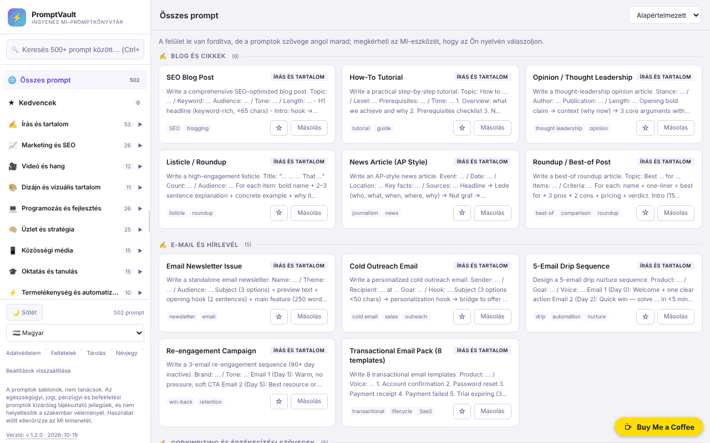

# PromptVault

[English](README.md) · [Română](README.ro.md) · [Français](README.fr.md) · [Italiano](README.it.md) · [Español](README.es.md) · [Português](README.pt.md) · [Deutsch](README.de.md) · **Magyar**

**Verzió:** 1.2.1 · **Utolsó frissítés:** 2026-10-22

A felület nyelvei: **Română, English, Français, Italiano, Español, Português (PT), Deutsch, Magyar** + további 8

Ingyenes MI-prompt-könyvtár egyetlen HTML-fájlban, kereséssel, kategóriákkal és 16 nyelvű felülettel.

**Online alkalmazás:** https://chiuta.github.io/PromptVault/

## Mi ez

A PromptVault a mesterséges intelligencia eszközeihez készült promptok könyvtára, kategóriák szerint rendezve (írás, marketing, videó és hang, dizájn, programozás stb.). Az alkalmazás „About” oldala szerint több mint 500 promptot tartalmaz 62 kategóriában. Az egész egyetlen `index.html` fájl, fiók és fizetés nélkül; a promptot egy kattintással másolod, és a kedvenc MI-eszközödbe illeszted.

## Funkciók

- Keresés a promptok között, a **Ctrl+K** (vagy Cmd+K) gyorsbillentyűvel, amely a kurzort a keresőmezőbe viszi.
- Navigáció kategóriák és alkategóriák szerint egy oldalpanelen (keskeny képernyőn a ☰ gombbal nyílik meg).
- Rendezés: „Default”, „A→Z”, „Z→A”.
- **[PLACEHOLDER] kitöltése** a prompt ablakában: mind az 502 prompt tartalmaz `[TOPIC]`-szerű helyőrzőket; a „Töltsd ki a helyeket” panel mindegyikhez létrehoz egy mezőt, az előnézet élőben frissül, a „Copy prompt” pedig a kitöltött szöveget másolja (az értékeket sehol sem tárolja).
- **Válasz a felület nyelvén** (angoltól eltérő nyelvek): a prompt ablakában egy beállítás, amely a végére hozzáfűzi a „Please write your answer in <nyelv>.” mondatot; maga a prompt angol marad. Az új szövegek mind a 16 nyelvre le vannak fordítva.
- **Copy prompt** (Prompt másolása) gomb minden prompt részletes ablakában, valamint **Copy** gomb a kártyán.
- Világos / sötét téma (☀️ Light / 🌙 Dark gomb); első indításkor a rendszer beállítását követi.
- 16 felületi nyelv: angol, román, spanyol, francia, német, olasz, portugál, holland, lengyel, orosz, arab, kínai, japán, koreai, török, magyar.
- Az oldalpanel húzással vagy a balra/jobbra nyílbillentyűkkel, a Home és az End billentyűvel átméretezhető, ha a fogantyún van a fókusz.
- **Kedvencek**: a kártyán lévő ☆ gomb vagy a prompt ablakában a „☆ Mentés a kedvencek közé” megjelöl egy promptot; az oldalpanel „★ Kedvencek” eleme (számlálóval) listázza őket. A lista csak ebben a böngészőben marad meg (`pv_fav`), 16 nyelven.
- Tájékoztató ablakok: Privacy, Terms, Storage, About; **Reset** gomb a mentett beállítások törléséhez (és a kedvencekéhez, megerősítés után).
- Megpróbál PWA-ként regisztrálni (a kódból generált manifest és service worker, csak biztonságos kapcsolaton / HTTPS-en).

## Használati útmutató

1. Nyisd meg az oldalt (vagy az `index.html` fájlt helyben).
2. Válaszd ki a nyelvet az oldalsáv „Language” listájából.
3. Válassz kategóriát az oldalsávból, vagy nyomd meg a **Ctrl+K** billentyűkombinációt, és írj be egy kulcsszót a keresőmezőbe.
4. Szükség esetén módosítsd a sorrendet a „Sort” listával.
5. Kattints egy kártyára a teljes prompt megnyitásához; a **Copy prompt** gombbal a vágólapra másolhatod. Ha a böngésző blokkolja a másolást, az alkalmazás megkér, hogy jelöld ki és másold kézzel.
6. Zárd be az ablakot a **Close** gombbal, a ✕-szel vagy az **Esc** billentyűvel.
7. A mentett beállítások (téma, panelszélesség, nyelv, kedvencek) törléséhez nyomd meg a **Reset** gombot a láblécben.

## Adatvédelem és hálózat

- **Helyi tárolás (localStorage):** négy kulcs: `pv_theme` (téma), `pv_sw` (az oldalpanel szélessége), `pv_lang` (nyelv) és `pv_fav` (a kedvenc címek listája). Sütiket nem használ. Az adatok nem hagyják el az eszközt.
- **Hálózat:** az alkalmazás kódjában nincsenek harmadik fél szervereihez intézett kérések, sem kívülről betöltött szkriptek, betűtípusok vagy képek. Az alkalmazás hivatkozásai (Buy Me a Coffee, alexio.tf, GitHub) csak akkor nyílnak meg, ha rájuk kattintasz.
- A helyben generált service worker elfogja az azonos eredetre irányuló GET kéréseket, és gyorsítótárba teszi őket későbbi újrafelhasználásra; más gazdagépekkel nem lép kapcsolatba.
- Az alkalmazás nem tartalmaz analitikát vagy telemetriát.

## Korlátok és jogi nyilatkozat

A promptok sablonok, nem tanácsok. Az egészség, a mentális egészség, az orvostudomány, a jog, a könyvelés/adózás, a befektetés/kereskedés és a biztosítás kategóriák kizárólag tájékoztató jellegűek, és nem helyettesítik a szakembert; az MI által generált eredményeket ellenőrizni kell. Erre vonatkozó megjegyzés az oldalsáv láblécében látható (angolul).

## Helyi / offline futtatás

Töltsd le az `index.html` fájlt, és nyisd meg egy böngészőben. Minden prompt, szöveg és nyelv a fájlban van, ezért internet nélkül is működik. A PWA/service worker funkcióhoz HTTPS-en keresztüli kiszolgálás szükséges (helyi fájlként megnyitva nem működik); a külső hivatkozásokhoz internet kell.

## Licenc

MIT — lásd a LICENSE fájlt.

A felületen található „About” és „Terms” szövegek (mind a 16 nyelven) most már ugyanazt a licencet, az MIT-t jelölik meg.

## Audit

Audit: 2026-10-10 — a README hálózatra és tárolásra vonatkozó állításai megfelelnek a kódnak (az egyetlen `fetch` a helyben generált service workerben van, azonos eredetre; CSP `connect-src 'none'`). Az oldalon szereplő licencet minden nyelven egységesítették (2026-10-11; jelenleg MIT); a lábléc jogi nyilatkozata most már mind a 15 nyelvre le van fordítva.

## Szerző

Alexio — Alexandru-Ionuț Chiuță. Elérhetőség: alexio@trom.tf

## Összefoglaló
A PromptVault egyfájlos, kliensoldali MI-prompt-könyvtár (a „Névjegy” oldala szerint 500+ prompt 62 kategóriában) kereséssel (Ctrl+K), rendezéssel, egykattintásos másolással, világos/sötét témával és 16 felületi nyelvvel. A localStorage-ban csak a témát, az oldalsáv szélességét, a nyelvet és a kedvencek listáját tárolja, és nem tölt be harmadik fél erőforrásokat; a külső hivatkozások csak kattintásra nyílnak meg. Letöltve offline is működik; az opcionális PWA-funkcióhoz HTTPS kell. MIT licenc.

## Előzmények / Changelog

### 1.2.1 — 2026-10-22
- Fordítási javítások: a promptok címei és címkéi le vannak fordítva ro, fr, it, es, pt, de és hu nyelvre (a keresés és a rendezés a kiválasztott nyelven működik); a hozzáférhetőségi címkék és az ugrólink követik a felület nyelvét. A promptok szövege szándékosan angol marad (AI-eszközökbe másolják).

### 1.1.0 — 2026-10-14
- Adatok biztonsági mentése és címkézése (fff-kit).

### 2026. október 12. (v1.0.0)
- 1.0.0 — 2026-10-12: a verzió és az utolsó frissítés dátuma megjelenik az alkalmazásban

### 2026. október 11.
- Kedvencek (☆/★ a kártyán és a prompt ablakában, „★ Kedvencek” elem számlálóval az oldalpanelen, tárolás a `localStorage`-ban `pv_fav` alatt, 15 nyelv); az alkalmazás „Storage” szabályzata most már a `pv_fav`-ot is felsorolja („három beállítás” helyett).
- Javítva: az alkalmazás globális `aside` stílusa az adományozó pirulára (`#tf-donate`) is érvényesült, ebből adódott a fehér téglalap a képernyőkép sarkában és a levágott ✕ gomb; mobilon a pirula kicsúszhatott a képernyőről. A pirula szabálya most már visszaállítja az örökölt tulajdonságokat.
- A `screenshot.png` frissítve (1280×800, román nyelvű felület).
- Prompt ablak: a `[PLACEHOLDER]`-ek interaktív kitöltése (másolás a kitöltött értékekkel) és „válasz a felület nyelvén” beállítás, 15 nyelven; Chromiumban tesztelve (előnézet, vágólap, 360 px vízszintes görgetés nélkül).
- CSP: `script-src` SHA-256 hash alapján, `'unsafe-inline'` nélkül.
- A HTML 23 `onclick`/`onchange` attribútumát egy delegált eseményfigyelő (`data-act`) váltotta fel; a viselkedés változatlan (ellenőrizve: menü, keresés, prompt ablak, másolás, nyelv, témák, jogi ablakok).
- Az oldalsáv számlálói (kategóriák és alkategóriák) most már az aktív keresést követik, így megegyeznek a megjelenített eredményekkel; keresés nélkül az összesített értékek maradnak (502 prompt, 62 kategória, 162 alkategória).
- Az angoltól eltérő nyelveken lefordított megjegyzés jelenik meg: a felület le van fordítva, de a promptok szövegei angolul maradnak (az 502 prompt 14 nyelvre fordítása nem készült el).
- `aside` az adományozó pirulához (axe: 0 szabálysértés).
