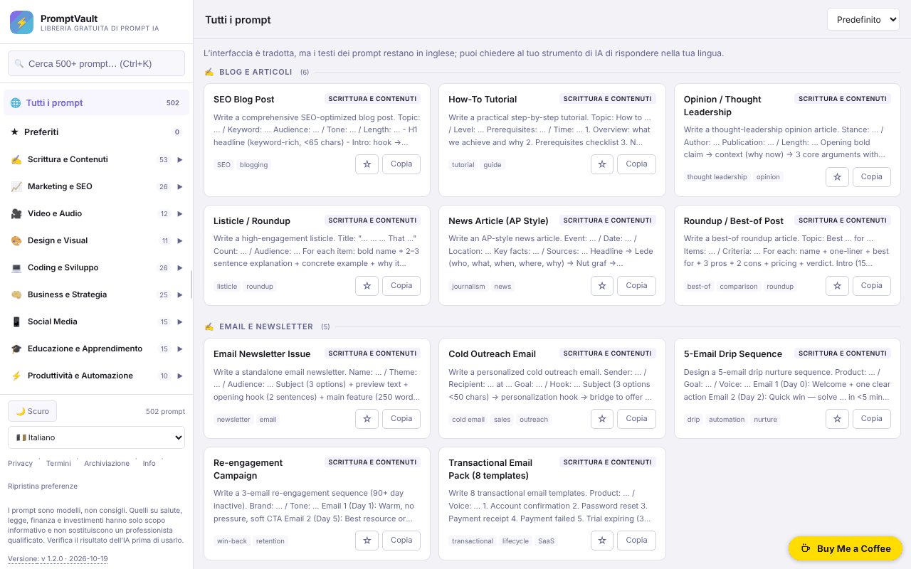

# PromptVault

[English](README.md) · [Română](README.ro.md) · [Français](README.fr.md) · **Italiano** · [Español](README.es.md) · [Português](README.pt.md) · [Deutsch](README.de.md) · [Magyar](README.hu.md)

**Versione:** 1.2.0 · **Ultimo aggiornamento:** 2026-10-19

Lingue dell'interfaccia: **Română, English, Français, Italiano, Español, Português (PT), Deutsch, Magyar** + altre 8

Una libreria gratuita di prompt per l'IA, in un unico file HTML, con ricerca, categorie e interfaccia in 16 lingue.

**App online:** https://chiuta.github.io/PromptVault/

## Cos'è

PromptVault è una libreria di prompt per strumenti di intelligenza artificiale, organizzata per categorie (scrittura, marketing, video e audio, design, programmazione ecc.). Secondo la pagina «About» dell'app, contiene oltre 500 prompt in 62 categorie. Tutto è in un unico file `index.html`, senza account e senza pagamento; il prompt si copia con un clic e si incolla nello strumento di IA preferito.

## Funzioni

- Ricerca nei prompt, con la scorciatoia **Ctrl+K** (o Cmd+K) per spostare il cursore nel campo di ricerca.
- Navigazione per categorie e sottocategorie, in un pannello laterale (sugli schermi stretti si apre con il pulsante ☰).
- Ordinamento: «Default», «A→Z», «Z→A».
- **Compilazione dei [PLACEHOLDER]** nella finestra del prompt: tutti i 502 prompt contengono segnaposto del tipo `[TOPIC]`; il pannello «Completa gli spazi» genera un campo per ciascuno, l'anteprima si aggiorna in tempo reale e «Copy prompt» copia il testo compilato (i valori non vengono salvati da nessuna parte).
- **Risposta nella lingua dell'interfaccia** (lingue ≠ inglese): opzione nella finestra del prompt che aggiunge in fondo la frase «Please write your answer in <lingua>.»; il prompt stesso resta in inglese. I nuovi testi sono tradotti nelle 16 lingue.
- Pulsante **Copy prompt** (Copia il prompt) nella finestra di dettaglio di ogni prompt, più un pulsante **Copy** sulla scheda.
- Tema chiaro / scuro (pulsante ☀️ Light / 🌙 Dark); alla prima esecuzione segue la preferenza del sistema.
- 16 lingue dell'interfaccia: inglese, romeno, spagnolo, francese, tedesco, italiano, portoghese, olandese, polacco, russo, arabo, cinese, giapponese, coreano, turco, ungherese.
- Pannello laterale ridimensionabile trascinando o con i tasti freccia sinistra/destra, Home e Fine quando la maniglia ha il focus.
- **Preferiti**: il pulsante ☆ sulla scheda o «☆ Salva nei preferiti» nella finestra del prompt contrassegna un prompt; la voce «★ Preferiti» nel pannello laterale (con contatore) li elenca. L'elenco è conservato solo in questo browser (`pv_fav`), in 16 lingue.
- Finestre informative: Privacy, Terms, Storage, About; pulsante **Reset** per cancellare le preferenze salvate (e i preferiti, dopo conferma).
- Tenta di registrarsi come PWA (manifest e service worker generati dal codice, solo su connessioni sicure / HTTPS).

## Guida all'uso

1. Apri la pagina (o il file `index.html` in locale).
2. Scegli la lingua dall'elenco «Language» nella barra laterale.
3. Scegli una categoria dalla barra laterale oppure premi **Ctrl+K** e digita una parola chiave nel campo di ricerca.
4. Facoltativamente, cambia l'ordine con l'elenco «Sort».
5. Fai clic su una scheda per aprire il prompt completo; premi **Copy prompt** per copiarlo negli appunti. Se il browser blocca la copia, l'app ti chiede di selezionare e copiare manualmente.
6. Chiudi la finestra con **Close**, con ✕ o con **Esc**.
7. Per cancellare le impostazioni salvate (tema, larghezza del pannello, lingua, preferiti), premi **Reset** nel piè di pagina.

## Privacy e rete

- **Archiviazione locale (localStorage):** quattro chiavi, `pv_theme` (tema), `pv_sw` (larghezza del pannello laterale), `pv_lang` (lingua) e `pv_fav` (elenco dei titoli preferiti). Non vengono usati cookie. I dati non lasciano il dispositivo.
- **Rete:** nel codice dell'app non ci sono richieste a server di terze parti, né script, font o immagini caricati dall'esterno. I link dell'app (Buy Me a Coffee, alexio.tf, GitHub) si aprono solo se li premi.
- Il service worker generato localmente intercetta le richieste GET alla stessa origine e le memorizza nella cache per un riutilizzo successivo; non contatta altri host.
- L'app non contiene analytics né telemetria.

## Limiti e avvertenza

I prompt sono modelli, non consigli. Le categorie salute, salute mentale, medicina, diritto, contabilità/fiscalità, investimenti/trading e assicurazioni sono strettamente informative e non sostituiscono uno specialista; i risultati generati dall'IA devono essere verificati. Una nota in tal senso è mostrata nel piè della barra laterale (in inglese).

## Esecuzione locale / offline

Scarica `index.html` e aprilo in un browser. Tutti i prompt, i testi e le lingue sono nel file, quindi funziona senza Internet. La funzione PWA/service worker richiede la distribuzione tramite HTTPS (non funziona se aperto come file locale); i link esterni richiedono Internet.

## Licenza

MIT — vedi il file LICENSE.

I testi «About» e «Terms» nell'interfaccia (in tutte le 16 lingue) indicano ora la stessa licenza, MIT.

## Audit

Audit: 2026-10-10 — le affermazioni del README su rete e archiviazione corrispondono al codice (l'unico `fetch` è nel service worker generato localmente, per la stessa origine; CSP `connect-src 'none'`). La licenza nella pagina è stata uniformata in tutte le lingue (2026-10-11; attualmente MIT); la nota di piè di pagina con l'avvertenza è ora tradotta nelle 15 lingue.

## Autore

Alexio — Alexandru-Ionuț Chiuță. Contatto: alexio@trom.tf

## English summary

PromptVault is a single-file, client-side library of AI prompts (500+ across 62 categories per its About page) with search (Ctrl+K), sorting, one-click copy, light/dark theme and 16 UI languages. It stores only theme, sidebar width, language and your favorites list in localStorage and loads no third-party resources; external links open only on click. Works offline when downloaded; the optional PWA feature needs HTTPS. Licensed MIT.

## Cronologia / Changelog

### 1.1.0 — 2026-10-14
- Backup e etichettatura dei dati (fff-kit).

### 12 ottobre 2026 (v1.0.0)
- 1.0.0 — 2026-10-12: la versione e la data dell'ultimo aggiornamento sono mostrate nell'app

### 11 ottobre 2026
- Preferiti (☆/★ sulla scheda e nella finestra del prompt, voce «★ Preferiti» con contatore nel pannello laterale, persistenza in `localStorage` sotto `pv_fav`, 15 lingue); la policy «Storage» dell'app elenca ora anche `pv_fav` (invece di «tre preferenze»).
- Corretto: lo stile globale `aside` dell'app si applicava anche alla pillola delle donazioni (`#tf-donate`), da cui il rettangolo bianco nell'angolo della schermata e il pulsante ✕ tagliato; su mobile la pillola poteva essere spinta fuori dallo schermo. La regola della pillola ora reimposta le proprietà ereditate.
- `screenshot.png` aggiornato (1280×800, interfaccia in romeno).
- Finestra del prompt: compilazione interattiva dei `[PLACEHOLDER]` (copia con i valori inseriti) e opzione «rispondi nella lingua dell'interfaccia», in 15 lingue; testato in Chromium (anteprima, appunti, 360 px senza scorrimento orizzontale).
- CSP: `script-src` su hash SHA-256, senza `'unsafe-inline'`.
- I 23 attributi `onclick`/`onchange` dell'HTML sono stati sostituiti da un listener delegato (`data-act`); comportamento invariato (verificato: menu, ricerca, finestra del prompt, copia, lingua, temi, finestre legali).
- I contatori della barra laterale (categorie e sottocategorie) seguono ora la ricerca attiva, quindi coincidono con i risultati mostrati; senza ricerca restano i totali (502 prompt, 62 categorie, 162 sottocategorie).
- Nelle lingue diverse dall'inglese compare una nota tradotta: l'interfaccia è tradotta, ma i testi dei prompt restano in inglese (la traduzione dei 502 prompt in 14 lingue non è stata fatta).
- `aside` per la pillola delle donazioni (axe: 0 violazioni).
