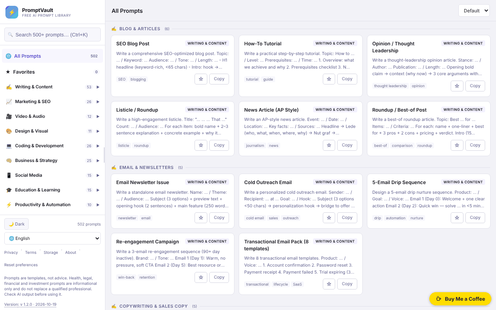

# PromptVault

**English** · [Română](README.ro.md) · [Français](README.fr.md) · [Italiano](README.it.md) · [Español](README.es.md) · [Português](README.pt.md) · [Deutsch](README.de.md) · [Magyar](README.hu.md)

**Version:** 1.2.3 · **Last updated:** 2026-10-22

Interface languages: **Română, English, Français, Italiano, Español, Português (PT), Deutsch, Magyar** + 8 more

A free library of AI prompts, in a single HTML file, with search, categories and an interface in 16 languages.

**Live app:** https://chiuta.github.io/PromptVault/

## What it is

PromptVault is a library of prompts for artificial intelligence tools, organised by category (writing, marketing, video and audio, design, programming, etc.). According to the app's "About" page, it contains over 500 prompts in 62 categories. Everything is a single `index.html` file, with no account and no payment; the prompt is copied with one click and pasted into your preferred AI tool.

## Features

- Search through prompts, with the **Ctrl+K** shortcut (or Cmd+K) to move the cursor into the search field.
- Navigation by categories and subcategories, in a side panel (on narrow screens it opens with the ☰ button).
- Sorting: "Default", "A→Z", "Z→A".
- **[PLACEHOLDER] filling** in the prompt window: all 502 prompts contain slots such as `[TOPIC]`; the "Fill in the blanks" panel generates a field for each one, the preview updates live, and "Copy prompt" copies the filled-in text (the values are not saved anywhere).
- **Answer in the interface language** (languages ≠ English): an option in the prompt window that appends the sentence "Please write your answer in <language>." at the end; the prompt itself stays in English. The new texts are translated into the 16 languages.
- **Copy prompt** button in the detail window of each prompt, plus a **Copy** button on the card.
- Light / dark theme (☀️ Light / 🌙 Dark button); on first run it follows the system preference.
- 16 interface languages: English, Romanian, Spanish, French, German, Italian, Portuguese, Dutch, Polish, Russian, Arabic, Chinese, Japanese, Korean, Turkish, Hungarian.
- Side panel resizable by dragging or with the left/right arrow keys, Home and End when the handle has focus.
- **Favourites**: the ☆ button on the card or "☆ Save to favourites" in the prompt window marks a prompt; the "★ Favourites" item in the side panel (with a counter) lists them. The list is kept only in this browser (`pv_fav`), in 16 languages.
- Information windows: Privacy, Terms, Storage, About; a **Reset** button to clear saved preferences (and favourites, after confirmation).
- Tries to register as a PWA (manifest and service worker generated from code, only over secure connections / HTTPS).

## User guide

1. Open the page (or the `index.html` file locally).
2. Choose the language from the "Language" list in the sidebar.
3. Choose a category from the sidebar or press **Ctrl+K** and type a keyword in the search field.
4. Optionally, change the order with the "Sort" list.
5. Click a card to open the full prompt; press **Copy prompt** to copy it to the clipboard. If the browser blocks copying, the app asks you to select and copy manually.
6. Close the window with **Close**, with ✕ or with **Esc**.
7. To clear saved settings (theme, panel width, language, favourites), press **Reset** in the footer.

## Privacy and network

- **Local storage (localStorage):** four keys, `pv_theme` (theme), `pv_sw` (side panel width), `pv_lang` (language) and `pv_fav` (list of favourite titles). No cookies are used. Data does not leave the device.
- **Network:** the app's code contains no requests to third-party servers, nor scripts, fonts or images loaded from outside. The links in the app (Buy Me a Coffee, alexio.tf, GitHub) open only if you click them.
- The locally generated service worker intercepts GET requests to the same origin and caches them for later reuse; it does not contact other hosts.
- The app contains no analytics or telemetry.

## Limitations and disclaimer

The prompts are templates, not advice. The categories health, mental health, medicine, law, accounting/taxation, investing/trading and insurance are strictly informational and do not replace a specialist; AI-generated results must be verified. A note to this effect is shown in the sidebar footer (in English).

## Local / offline use

Download `index.html` and open it in a browser. All prompts, texts and languages are in the file, so it works without internet. The PWA/service worker feature requires serving over HTTPS (it does not work when opened as a local file); external links require internet.

## Licence

MIT — see the LICENSE file.

The "About" and "Terms" texts in the interface (all 16 languages) now indicate the same licence, MIT.

## Audit

Audit: 2026-10-10 — the network/storage claims in the README match the code (the only `fetch` is in the locally generated service worker, for the same origin; CSP `connect-src 'none'`). The licence on the page was unified across all languages (2026-10-11; currently MIT); the footer disclaimer note is now translated into the 15 languages.

## Author

Alexio — Alexandru-Ionuț Chiuță. Contact: alexio@trom.tf

## English summary

PromptVault is a single-file, client-side library of AI prompts (500+ across 62 categories per its About page) with search (Ctrl+K), sorting, one-click copy, light/dark theme and 16 UI languages. It stores only theme, sidebar width, language and your favorites list in localStorage and loads no third-party resources; external links open only on click. Works offline when downloaded; the optional PWA feature needs HTTPS. Licensed MIT.

## History / Changelog

- 1.2.3 — 2026-10-22: Real `sw.js` + manifest + icons (the invalid blob: service worker removed, so the offline shell now works after the first visit); the four alert()/confirm() calls are replaced by in-page notices and a dialog; the missing “copy failed” and “reset favorites” texts added in the 8 languages (the confirmation used to show a raw key); text ≥ 12 px on mobile.

- 1.2.2 — 2026-10-22: **fix**: the (screen-reader) label of the language selector now follows the selected language.
### 1.2.1 — 2026-10-22
- Translation fixes: prompt titles and tags are now translated in ro, fr, it, es, pt, de and hu (search and sorting work in the chosen language); accessibility labels and the skip link follow the interface language. Prompt bodies stay in English on purpose (they are pasted into AI tools).

### 1.1.0 — 2026-10-14
- Backup and data labelling (fff-kit).

### 12 October 2026 (v1.0.0)
- 1.0.0 — 2026-10-12: the version and the date of the last update are shown in the app

### 11 October 2026
- Favourites (☆/★ on the card and in the prompt window, "★ Favourites" item with a counter in the side panel, persistence in `localStorage` under `pv_fav`, 15 languages); the app's "Storage" policy now also lists `pv_fav` (instead of "three preferences").
- Fixed: the app's global `aside` style was also applied to the donation pill (`#tf-donate`), causing the white rectangle in the corner of the screenshot and the clipped ✕ button; on mobile the pill could be pushed off screen. The pill rule now resets the inherited properties.
- `screenshot.png` refreshed (1280×800, interface in Romanian).
- Prompt window: interactive filling of `[PLACEHOLDER]`s (copying with the filled-in values) and an "answer in the interface language" option, in 15 languages; tested in Chromium (preview, clipboard, 360 px with no horizontal scroll).
- CSP: `script-src` on SHA-256 hash, without `'unsafe-inline'`.
- The 23 `onclick`/`onchange` attributes in the HTML were replaced with a delegated listener (`data-act`); behaviour unchanged (verified: menu, search, prompt window, copy, language, themes, legal windows).
- The sidebar counters (categories and subcategories) now follow the active search, so they match the displayed results; without a search they remain the totals (502 prompts, 62 categories, 162 subcategories).
- In languages other than English a translated note appears: the interface is translated, but the prompt texts remain in English (translating the 502 prompts into 14 languages has not been done).
- `aside` for the donation pill (axe: 0 violations).
