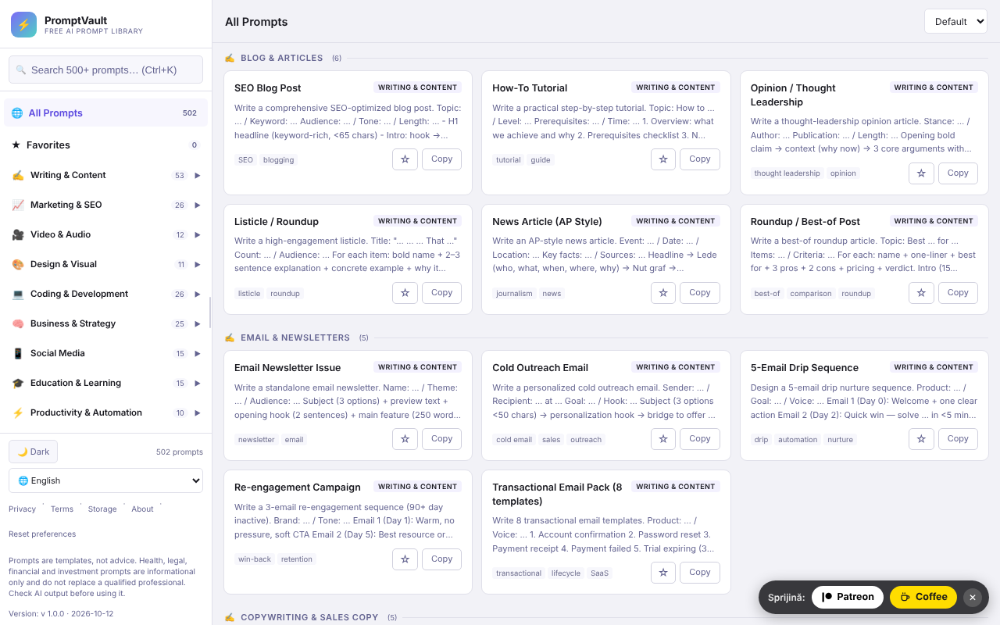

# PromptVault

**Versiune:** 1.1.0 · **Ultima actualizare:** 14 octombrie 2026

Bibliotecă gratuită de prompturi AI, într-un singur fișier HTML, cu căutare, categorii și interfață în 15 limbi.

**Live:** https://chiuta.github.io/PromptVault/

## Ce este

PromptVault este o bibliotecă de prompturi pentru instrumente de inteligență artificială, organizată pe categorii (scriere, marketing, video și audio, design, programare etc.). Conform paginii „About” din aplicație, conține peste 500 de prompturi în 62 de categorii. Totul este un singur fișier `index.html`, fără cont și fără plată; promptul se copiază cu un clic și se lipește în instrumentul AI preferat.

## Funcții

- Căutare în prompturi, cu scurtătura **Ctrl+K** (sau Cmd+K) pentru a muta cursorul în câmpul de căutare.
- Navigare pe categorii și subcategorii, într-un panou lateral (pe ecrane înguste se deschide cu butonul ☰).
- Sortare: „Default”, „A→Z”, „Z→A”.
- **Completare [PLACEHOLDER]** în fereastra promptului: toate cele 502 prompturi conțin spații de tip `[TOPIC]`; panoul „Completează spațiile” generează câte un câmp pentru fiecare, previzualizarea se actualizează live, iar „Copy prompt” copiază textul completat (valorile nu sunt salvate nicăieri).
- **Răspuns în limba interfeței** (limbi ≠ engleză): opțiune în fereastra promptului, care adaugă la final propoziția „Please write your answer in <limba>.”; promptul în sine rămâne în engleză. Textele noi sunt traduse în cele 15 limbi.
- Buton **Copy prompt** (Copiază promptul) în fereastra de detaliu a fiecărui prompt, plus buton **Copy** pe card.
- Temă luminoasă / întunecată (buton ☀️ Light / 🌙 Dark); la prima rulare se urmează preferința sistemului.
- 15 limbi de interfață: engleză, română, spaniolă, franceză, germană, italiană, portugheză, olandeză, poloneză, rusă, arabă, chineză, japoneză, coreeană, turcă.
- Panou lateral redimensionabil prin tragere sau cu tastele săgeți stânga/dreapta, Home și End când mânerul are focus.
- **Favorite**: butonul ☆ de pe card sau „☆ Salvează la favorite” din fereastra promptului marchează un prompt; elementul „★ Favorite” din panoul lateral (cu contor) îl listează. Lista se păstrează doar în acest browser (`pv_fav`), în 15 limbi.
- Ferestre informative: Privacy, Terms, Storage, About; buton **Reset** pentru ștergerea preferințelor salvate (și a favoritelor, după confirmare).
- Încearcă să se înregistreze ca PWA (manifest și service worker generate din cod, doar pe conexiuni securizate / HTTPS).

## Manual de utilizare

1. Deschide pagina (sau fișierul `index.html` local).
2. Alege limba din lista „Language” din bara laterală.
3. Alege o categorie din bara laterală sau apasă **Ctrl+K** și scrie un cuvânt-cheie în câmpul de căutare.
4. Opțional, schimbă ordinea cu lista „Sort”.
5. Apasă pe un card pentru a deschide promptul complet; apasă **Copy prompt** pentru a-l copia în clipboard. Dacă browserul blochează copierea, aplicația cere să selectezi și să copiezi manual.
6. Închide fereastra cu **Close**, cu ✕ sau cu **Esc**.
7. Pentru a șterge setările salvate (temă, lățime panou, limbă, favorite), apasă **Reset** din subsol.

## Confidențialitate și rețea

- **Stocare locală (localStorage):** patru chei, `pv_theme` (temă), `pv_sw` (lățimea panoului lateral), `pv_lang` (limbă) și `pv_fav` (lista titlurilor favorite). Nu se folosesc cookie-uri. Datele nu părăsesc dispozitivul.
- **Rețea:** în codul aplicației nu există cereri către servere terțe, nici scripturi, fonturi sau imagini încărcate din exterior. Linkurile din aplicație (Patreon, Buy Me a Coffee, alexio.tf, GitHub) se deschid doar dacă le apeși.
- Service worker-ul generat local interceptează cererile GET către aceeași origine și le ține în cache, pentru reutilizare ulterioară; nu contactează alte gazde.
- Aplicația nu conține analytics sau telemetrie.

## Limitări și disclaimer

Prompturile sunt șabloane, nu sfaturi. Categoriile de sănătate, sănătate mintală, medicină, drept, contabilitate/fiscalitate, investiții/trading și asigurări sunt strict informative și nu înlocuiesc un specialist; rezultatele generate de AI trebuie verificate. O notă în acest sens este afișată în subsolul barei laterale (în engleză).

## Rulare locală / offline

Descarcă `index.html` și deschide-l în browser. Toate prompturile, textele și limbile sunt în fișier, deci funcționează fără internet. Funcția PWA/service worker necesită servire prin HTTPS (nu funcționează la deschiderea ca fișier local); linkurile externe necesită internet.

## Licență

MIT — vezi fișierul LICENSE.

Textele „About” și „Terms” din interfață (toate cele 15 limbi) indică acum aceeași licență, MIT.

## Audit

Audit: 2026-10-10 — afirmațiile de rețea/stocare din README corespund codului (singurul `fetch` este în service worker-ul generat local, pentru aceeași origine; CSP `connect-src 'none'`). Licența din pagină a fost unificată în toate limbile (2026-10-11; în prezent MIT); nota de subsol cu disclaimer este acum tradusă în cele 15 limbi.

## Autor

Alexio — Alexandru-Ionuț Chiuță. Contact: alexio@trom.tf

## English summary

PromptVault is a single-file, client-side library of AI prompts (500+ across 62 categories per its About page) with search (Ctrl+K), sorting, one-click copy, light/dark theme and 15 UI languages. It stores only theme, sidebar width, language and your favorites list in localStorage and loads no third-party resources; external links open only on click. Works offline when downloaded; the optional PWA feature needs HTTPS. Licensed MIT.

## Istoric / Changelog

### 1.1.0 — 2026-10-14
- Copie de rezervă și etichetare date (fff-kit).

### 12 octombrie 2026 (v1.0.0)
- 1.0.0 — 2026-10-12: versiunea și data ultimei actualizări sunt afișate în aplicație

### 11 octombrie 2026
- Favorite (☆/★ pe card și în fereastra promptului, element „★ Favorite” cu contor în panoul lateral, persistență în `localStorage` sub `pv_fav`, 15 limbi); politica „Storage” din aplicație listează acum și `pv_fav` (în loc de „trei preferințe”).
- Reparat: stilul global `aside` al aplicației se aplica și pastilei de donații (`#tf-donate`), de unde dreptunghiul alb din colț în captură și butonul ✕ tăiat; pe mobil pastila putea fi împinsă în afara ecranului. Regula pastilei resetează acum proprietățile moștenite.
- `screenshot.png` reactualizat (1280×800, interfață în română).
- Fereastra promptului: completare interactivă a `[PLACEHOLDER]`-elor (copiere cu valorile completate) și opțiune „răspunde în limba interfeței”, în 15 limbi; testat în Chromium (previzualizare, clipboard, 360 px fără scroll orizontal).
- CSP: `script-src` pe hash SHA-256, fără `'unsafe-inline'`.
- Cele 23 de atribute `onclick`/`onchange` din HTML au fost înlocuite cu un ascultător delegat (`data-act`); comportamentul este neschimbat (verificat: meniu, căutare, fereastră prompt, copiere, limbă, teme, ferestre legale).
- Contoarele din bara laterală (categorii și subcategorii) urmăresc acum căutarea activă, deci coincid cu rezultatele afișate; fără căutare rămân totalurile (502 prompturi, 62 categorii, 162 subcategorii).
- În limbile diferite de engleză apare o notă traducată: interfața e tradusă, dar textele prompturilor rămân în engleză (traducerea celor 502 prompturi în 14 limbi nu a fost făcută).
- `aside` pentru pastila de donații (axe: 0 încălcări).
