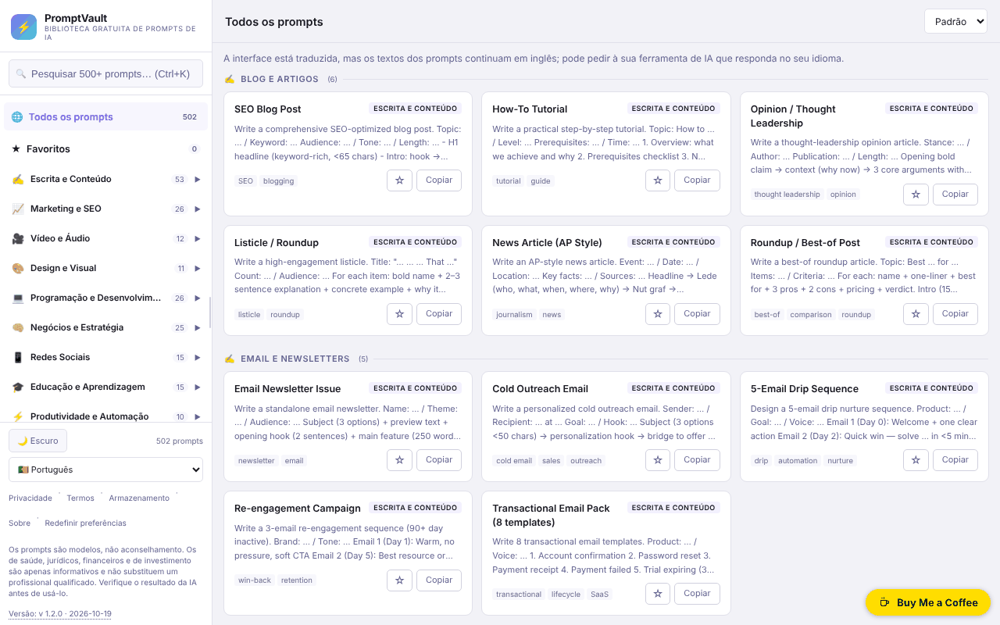

# PromptVault

[English](README.md) · [Română](README.ro.md) · [Français](README.fr.md) · [Italiano](README.it.md) · [Español](README.es.md) · **Português** · [Deutsch](README.de.md) · [Magyar](README.hu.md)

**Versão:** 2.1.0 · **Última atualização:** 2026-10-27

Idiomas da interface: **Română, English, Français, Italiano, Español, Português (PT), Deutsch, Magyar** + mais 8

Uma biblioteca gratuita de prompts de IA, num único ficheiro HTML, com pesquisa, categorias e interface em 16 línguas.

**Aplicação online:** https://chiuta.github.io/PromptVault/

## O que é

O PromptVault é uma biblioteca de prompts para ferramentas de inteligência artificial, organizada por categorias (escrita, marketing, vídeo e áudio, design, programação, etc.). Segundo a página «About» da aplicação, contém mais de 500 prompts em 62 categorias. Tudo é um único ficheiro `index.html`, sem conta e sem pagamento; o prompt copia-se com um clique e cola-se na ferramenta de IA preferida.

## Funcionalidades

- Pesquisa nos prompts, com o atalho **Ctrl+K** (ou Cmd+K) para mover o cursor para o campo de pesquisa.
- Navegação por categorias e subcategorias, num painel lateral (em ecrãs estreitos abre-se com o botão ☰).
- Ordenação: «Default», «A→Z», «Z→A».
- **Preenchimento de [PLACEHOLDER]** na janela do prompt: os 502 prompts contêm espaços do tipo `[TOPIC]`; o painel «Preenche os espaços» gera um campo para cada um, a pré-visualização atualiza-se em direto e «Copy prompt» copia o texto preenchido (os valores não são guardados em lado nenhum).
- **Resposta na língua da interface** (línguas ≠ inglês): opção na janela do prompt que acrescenta no final a frase «Please write your answer in <língua>.»; o prompt em si permanece em inglês. Os textos novos estão traduzidos nas 16 línguas.
- Botão **Copy prompt** (Copiar o prompt) na janela de detalhe de cada prompt, além de um botão **Copy** no cartão.
- Tema claro / escuro (botão ☀️ Light / 🌙 Dark); na primeira execução segue a preferência do sistema.
- 16 línguas de interface: inglês, romeno, espanhol, francês, alemão, italiano, português, neerlandês, polaco, russo, árabe, chinês, japonês, coreano, turco, húngaro.
- Painel lateral redimensionável por arrastamento ou com as teclas de seta esquerda/direita, Home e End quando a pega tem o foco.
- **Favoritos**: o botão ☆ do cartão ou «☆ Guardar nos favoritos» na janela do prompt marca um prompt; o item «★ Favoritos» do painel lateral (com contador) lista-os. A lista é guardada apenas neste navegador (`promptvault.fav`), em 16 línguas.
- Janelas informativas: Privacy, Terms, Storage, About; botão **Reset** para apagar as preferências guardadas (e os favoritos, após confirmação).
- Tenta registar-se como PWA (manifesto e service worker gerados a partir do código, apenas em ligações seguras / HTTPS).

## Guia de utilização

1. Abre a página (ou o ficheiro `index.html` localmente).
2. Escolhe a língua na lista «Language» da barra lateral.
3. Escolhe uma categoria na barra lateral ou prime **Ctrl+K** e escreve uma palavra-chave no campo de pesquisa.
4. Opcionalmente, altera a ordem com a lista «Sort».
5. Clica num cartão para abrir o prompt completo; prime **Copy prompt** para o copiar para a área de transferência. Se o navegador bloquear a cópia, a aplicação pede-te que o selecciones e copies manualmente.
6. Fecha a janela com **Close**, com ✕ ou com **Esc**.
7. Para apagar as definições guardadas (tema, largura do painel, língua, favoritos), prime **Reset** no rodapé.

## Privacidade e rede

- **Armazenamento local (localStorage):** quatro chaves, `promptvault.theme` (tema), `promptvault.sw` (largura do painel lateral), `promptvault.lang` (língua) e `promptvault.fav` (lista de títulos favoritos). Não são usados cookies. Os dados não saem do dispositivo.
- **Rede:** no código da aplicação não existem pedidos a servidores de terceiros, nem scripts, tipos de letra ou imagens carregados do exterior. As ligações da aplicação (Buy Me a Coffee, alexio.tf, GitHub) só se abrem se clicares nelas.
- O service worker gerado localmente interceta os pedidos GET à mesma origem e guarda-os em cache para reutilização posterior; não contacta outros anfitriões.
- A aplicação não contém analítica nem telemetria.

## Limitações e aviso legal

Os prompts são modelos, não aconselhamento. As categorias saúde, saúde mental, medicina, direito, contabilidade/fiscalidade, investimento/trading e seguros são estritamente informativas e não substituem um especialista; os resultados gerados pela IA têm de ser verificados. Uma nota nesse sentido é apresentada no rodapé da barra lateral (em inglês).

## Execução local / offline

Descarrega `index.html` e abre-o num navegador. Todos os prompts, textos e línguas estão no ficheiro, pelo que funciona sem internet. A funcionalidade PWA/service worker requer disponibilização por HTTPS (não funciona quando aberto como ficheiro local); as ligações externas requerem internet.

## Licença

MIT — ver o ficheiro LICENSE.

Os textos «About» e «Terms» da interface (em todas as 16 línguas) indicam agora a mesma licença, MIT.

## Auditoria

Auditoria: 2026-10-10 — as afirmações sobre rede e armazenamento do README correspondem ao código (o único `fetch` está no service worker gerado localmente, para a mesma origem; CSP `connect-src 'none'`). A licença apresentada na página foi unificada em todas as línguas (2026-10-11; atualmente MIT); a nota de rodapé com o aviso legal está agora traduzida nas 15 línguas.

## Autor

Alexio — Alexandru-Ionuț Chiuță. Contacto: alexio@trom.tf

## Resumo

O PromptVault é uma biblioteca de prompts de IA do lado do cliente, num único ficheiro (mais de 500 em 62 categorias, segundo a sua página «Sobre»), com pesquisa (Ctrl+K), ordenação, cópia com um clique, tema claro/escuro e 16 idiomas de interface. Guarda apenas o tema, a largura da barra lateral, o idioma e a lista de favoritos em localStorage e não carrega recursos de terceiros; as ligações externas abrem apenas ao clicar. Funciona offline depois de descarregado; a funcionalidade PWA opcional requer HTTPS. Licença MIT.

## Histórico / Changelog

### 1.2.7 — 2026-10-23

- As chaves do armazenamento local passam a usar o prefixo `promptvault.` (`FFF.store.migrate` no arranque, antes de qualquer leitura): os dados existentes são mantidos automaticamente e as cópias `.fff.json` antigas continuam a poder ser importadas.

### 1.2.5 — 2026-10-22

fff-kit 1.1.4: alvos de toque e tamanho mínimo do texto; alvos de toque e texto corrigidos.

- 1.2.4 — 2026-10-22: fff-kit 1.1.2: PBKDF2 com 600.000 iterações, proteção anti-clickjacking
- 1.2.3 — 2026-10-22: `sw.js` real + manifesto + ícones (o service worker blob: inválido foi removido, pelo que a estrutura offline funciona após a primeira visita); os quatro alert()/confirm() foram substituídos por avisos integrados e um diálogo; adicionados nos 8 idiomas os textos em falta «falha ao copiar» e «repor favoritos» (a confirmação mostrava uma chave em bruto); texto ≥ 12 px em telemóvel.

- 1.2.2 — 2026-10-22: **correção**: o rótulo (para leitores de ecrã) do seletor de idioma segue agora o idioma escolhido.
### 1.2.1 — 2026-10-22
- Correções de tradução: os títulos e as etiquetas dos prompts estão traduzidos em ro, fr, it, es, pt, de e hu (a pesquisa e a ordenação funcionam no idioma escolhido); as etiquetas de acessibilidade e a ligação de salto seguem o idioma da interface. O corpo dos prompts fica intencionalmente em inglês (é colado em ferramentas de IA).

### 1.1.0 — 2026-10-14
- Cópia de segurança e etiquetagem de dados (fff-kit).

### 12 de outubro de 2026 (v1.0.0)
- 1.0.0 — 2026-10-12: a versão e a data da última atualização são apresentadas na aplicação

### 11 de outubro de 2026
- Favoritos (☆/★ no cartão e na janela do prompt, item «★ Favoritos» com contador no painel lateral, persistência em `localStorage` sob `promptvault.fav`, 15 línguas); a política «Storage» da aplicação passa a listar também `promptvault.fav` (em vez de «três preferências»).
- Corrigido: o estilo global `aside` da aplicação aplicava-se também à pílula de donativos (`#tf-donate`), daí o retângulo branco no canto da captura e o botão ✕ cortado; no telemóvel a pílula podia ser empurrada para fora do ecrã. A regra da pílula repõe agora as propriedades herdadas.
- `screenshot.png` atualizada (1280×800, interface em romeno).
- Janela do prompt: preenchimento interativo dos `[PLACEHOLDER]` (cópia com os valores preenchidos) e opção «responder na língua da interface», em 15 línguas; testado no Chromium (pré-visualização, área de transferência, 360 px sem deslocamento horizontal).
- CSP: `script-src` com hash SHA-256, sem `'unsafe-inline'`.
- Os 23 atributos `onclick`/`onchange` do HTML foram substituídos por um ouvinte delegado (`data-act`); comportamento inalterado (verificado: menu, pesquisa, janela do prompt, cópia, língua, temas, janelas legais).
- Os contadores da barra lateral (categorias e subcategorias) acompanham agora a pesquisa ativa, pelo que coincidem com os resultados apresentados; sem pesquisa mantêm-se os totais (502 prompts, 62 categorias, 162 subcategorias).
- Nas línguas diferentes do inglês surge uma nota traduzida: a interface está traduzida, mas os textos dos prompts permanecem em inglês (a tradução dos 502 prompts para 14 línguas não foi feita).
- `aside` para a pílula de donativos (axe: 0 violações).
